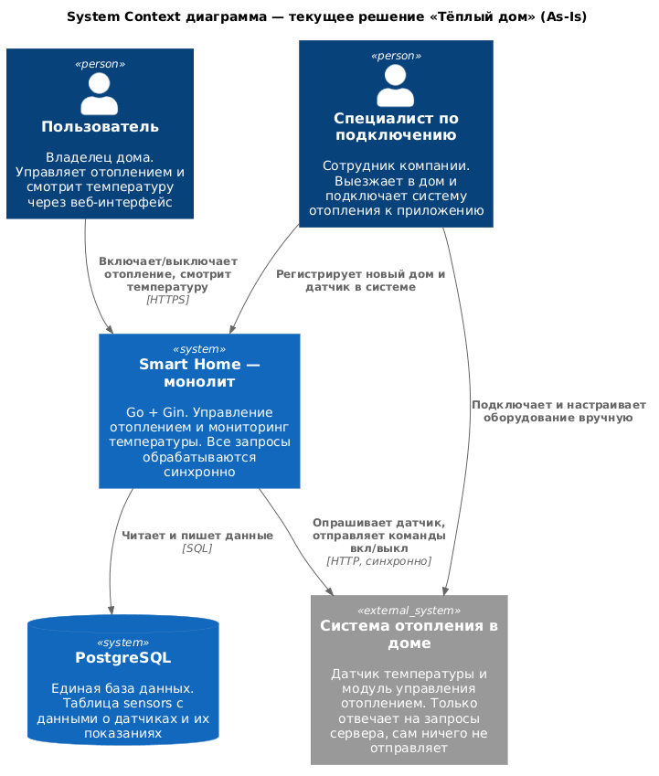
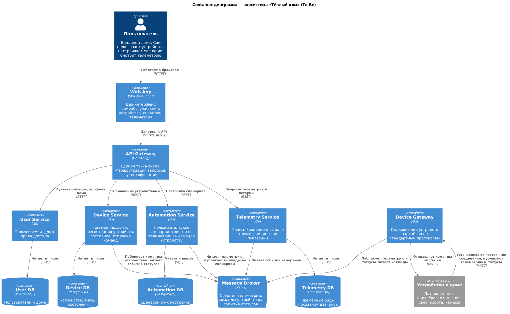
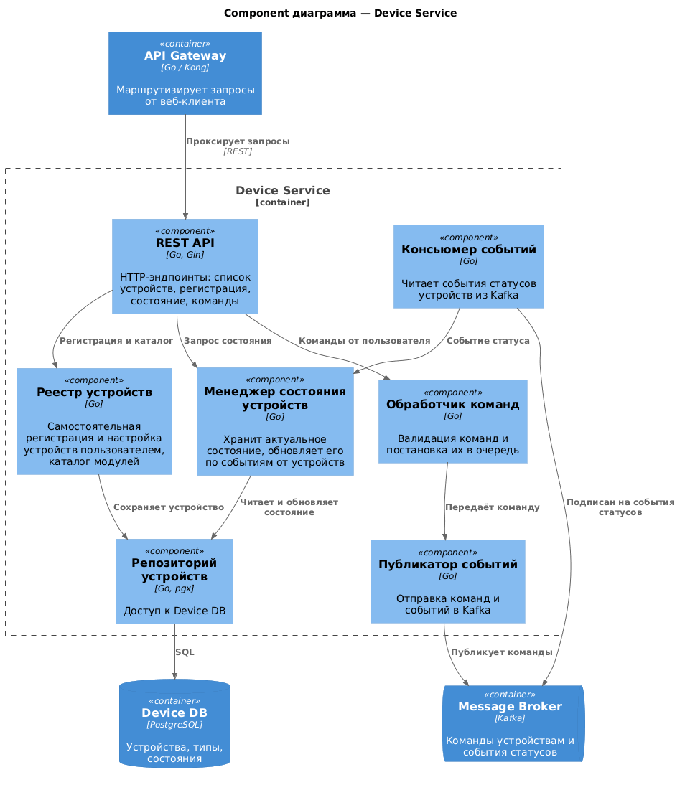
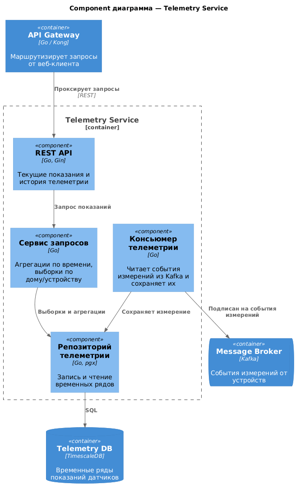
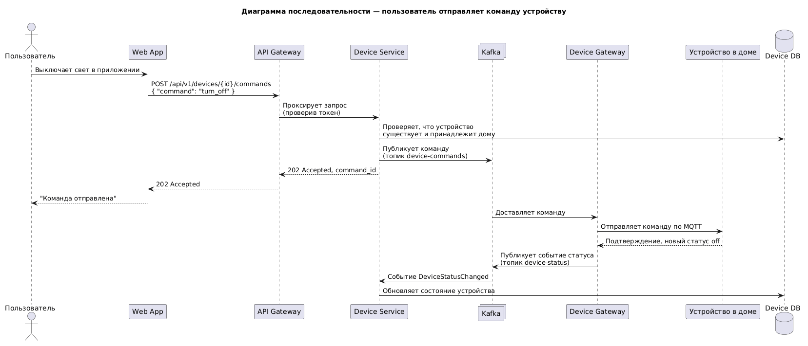
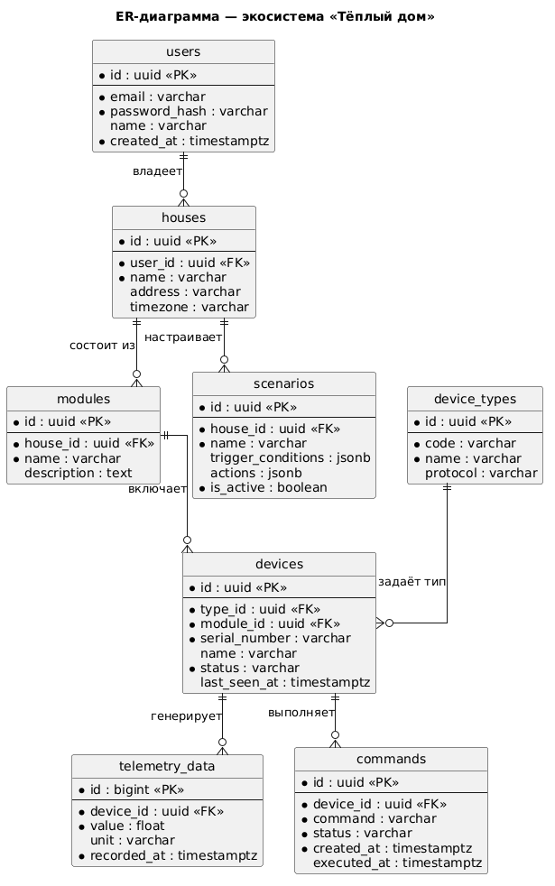

# Project_template

Это шаблон для решения проектной работы. Структура этого файла повторяет структуру заданий. Заполняйте его по мере работы над решением.

# Задание 1. Анализ и планирование

<aside>

Чтобы составить документ с описанием текущей архитектуры приложения, можно часть информации взять из описания компании и условия задания. Это нормально.

</aside>

### 1. Описание функциональности монолитного приложения

**Управление отоплением:**

- Пользователи могут удалённо включать и выключать отопление в своём доме через веб-интерфейс.
- Система поддерживает только переключение состояния отопления. Команда уходит с сервера напрямую на модуль управления в доме.
- Подключить дом к системе может только специалист компании, выезд на место обязателен. Самостоятельно добавить датчик пользователь не может.

**Мониторинг температуры:**

- Пользователи могут смотреть текущую температуру в доме через веб-интерфейс.
- Система получает данные о температуре, сама опрашивая датчики: сервер отправляет запрос к датчику и ждёт ответа.
- Хранится только текущее значение, истории показаний нет.

### 2. Анализ архитектуры монолитного приложения

- Язык программирования: Go, веб-фреймворк Gin.
- База данных: PostgreSQL, одна общая база на всё приложение (по сути одна таблица sensors).
- Архитектура: монолитная. Обработка HTTP-запросов, бизнес-логика и работа с данными живут в одном приложении и деплоятся вместе.
- Взаимодействие: синхронное, запросы обрабатываются последовательно. Когда нужна температура, сервер сам делает запрос к датчику и ждёт ответа. Датчики сами ничего не отправляют.
- Масштабируемость: масштабировать можно только всё приложение целиком, отдельные части — нельзя.
- Развертывание: при любом обновлении приходится останавливать всё приложение.
- Текущая нагрузка: 100 веб-клиентов и 100 подключённых модулей управления отоплением.

### 3. Определение доменов и границы контекстов

**As-Is (что есть сейчас):**

- Домен «Управление отоплением». Внутри него два контекста: управление устройствами (вкл/выкл отопления, регистрация датчиков) и мониторинг температуры (получение показаний). Сейчас оба свалены в один монолит.

**To-Be (целевая экосистема):**

- «Пользователи и дома» — регистрация, аккаунты, привязка домов, права доступа.
- «Управление устройствами» — каталог модулей, самостоятельное подключение устройств пользователем, состояние устройств, отправка команд.
- «Телеметрия и мониторинг» — сбор и хранение показаний с датчиков, история.
- «Автоматизация» — пользовательские сценарии (например, «если температура ниже 18 — включить отопление»).
- «Интеграция с устройствами» — шлюз для подключения устройств партнёров по стандартным протоколам.
- «Уведомления» — оповещения пользователей о событиях в доме.

### **4. Проблемы монолитного решения**

- Нет самообслуживания: каждое подключение — это выезд специалиста. С таким подходом SaaS-модель и подключение посёлков масштабировать не получится.
- Всё синхронно и идёт от сервера к датчику. Пока датчиков 100 — терпимо, но когда их станут десятки тысяч, постоянный опрос всех датчиков сервером станет узким местом.
- Единая точка отказа: упало приложение — у всех пользователей разом перестало работать всё.
- Масштабировать можно только целиком. Даже если растёт нагрузка только на опрос датчиков, придётся поднимать копии всего приложения.
- Любое обновление — это остановка всего сервиса для всех пользователей.
- Чтобы добавить новый тип устройств (свет, ворота, камеры), придётся лезть в общий код и общую базу, рискуя сломать то, что уже работает.

### 5. Визуализация контекста системы — диаграмма С4

Диаграмма контекста текущего монолита:

[PlantUML-исходник](diagrams/context/monolith-context.puml)


# Задание 2. Проектирование микросервисной архитектуры

В этом задании вам нужно предоставить только диаграммы в модели C4. Мы не просим вас отдельно описывать получившиеся микросервисы и то, как вы определили взаимодействия между компонентами To-Be системы. Если вы правильно подготовите диаграммы C4, они и так это покажут.

**Диаграмма контейнеров (Containers)**

[PlantUML-исходник](diagrams/container/warmhouse-containers.puml)


**Диаграмма компонентов (Components)**

[PlantUML-исходник](diagrams/component/device-service-components.puml)


[PlantUML-исходник](diagrams/component/telemetry-service-components.puml)


**Диаграмма кода (Code)**

[PlantUML-исходник](diagrams/code/device-command-sequence.puml)


# Задание 3. Разработка ER-диаграммы

Сущности собрал по микросервисам из задания 2:

- **users** — пользователи (User Service)
- **houses** — дома, привязаны к пользователю (User Service)
- **modules** — комплекты/модули умного дома, которые пользователь покупает и ставит в дом (Device Service)
- **device_types** — справочник типов устройств: heating, light, gate, camera, sensor (Device Service)
- **devices** — конкретные устройства с серийным номером и текущим состоянием (Device Service)
- **telemetry_data** — показания датчиков, временной ряд (Telemetry Service)
- **scenarios** — пользовательские сценарии, триггеры и действия лежат в jsonb (Automation Service)
- **commands** — команды устройствам с отслеживанием статуса доставки (Device Service)

Связи: пользователь владеет несколькими домами (1:N), дом состоит из модулей (1:N), модуль включает устройства (1:N), тип устройства задаётся справочником (1:N), устройство генерирует телеметрию (1:N) и выполняет команды (1:N), к дому привязаны сценарии (1:N).

[PlantUML-исходник](diagrams/er/warmhouse-er.puml)


# Задание 4. Создание и документирование API

### 1. Тип API

Использую оба типа, потому что взаимодействия в системе двух видов:

- **REST API (OpenAPI)** — для синхронных запросов, где клиенту нужен ответ сразу: получить список устройств, посмотреть состояние, зарегистрировать устройство. Так общаются веб-клиент и API Gateway с микросервисами.
- **AsyncAPI** — для событий, которые идут через Kafka: новые измерения температуры и изменения статусов устройств. Здесь ждать ответа не нужно, издатель просто публикует событие, а подписчики разбирают его когда смогут. Это развязывает сервисы и не блокирует систему на ожидании железа.

### 2. Документация API

- REST API для Device Service (информация об устройстве, список устройств, регистрация, обновление состояния, отправка команды): [api/device-service.openapi.yaml](api/device-service.openapi.yaml)
- Асинхронные события телеметрии и статусов устройств (Kafka-топики telemetry.measurements и devices.status): [api/telemetry.asyncapi.yaml](api/telemetry.asyncapi.yaml)

# Задание 5. Работа с docker и docker-compose

Перейдите в apps.

Там находится приложение-монолит для работы с датчиками температуры. В README.md описано как запустить решение.

Вам нужно:

1) сделать простое приложение temperature-api на любом удобном для вас языке программирования, которое при запросе /temperature?location= будет отдавать рандомное значение температуры.

Locations - название комнаты, sensorId - идентификатор названия комнаты

```
	// If no location is provided, use a default based on sensor ID
	if location == "" {
		switch sensorID {
		case "1":
			location = "Living Room"
		case "2":
			location = "Bedroom"
		case "3":
			location = "Kitchen"
		default:
			location = "Unknown"
		}
	}

	// If no sensor ID is provided, generate one based on location
	if sensorID == "" {
		switch location {
		case "Living Room":
			sensorID = "1"
		case "Bedroom":
			sensorID = "2"
		case "Kitchen":
			sensorID = "3"
		default:
			sensorID = "0"
		}
	}
```

2) Приложение следует упаковать в Docker и добавить в docker-compose. Порт по умолчанию должен быть 8081

3) Кроме того для smart_home приложения требуется база данных - добавьте в docker-compose файл настройки для запуска postgres с указанием скрипта инициализации ./smart_home/init.sql

Для проверки можно использовать Postman коллекцию smarthome-api.postman_collection.json и вызвать:

- Create Sensor
- Get All Sensors

Должно при каждом вызове отображаться разное значение температуры

Ревьюер будет проверять точно так же.


